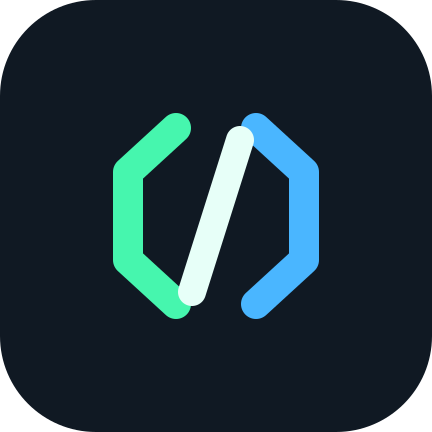

# Android China Setup



为 Android 11+ 提供精简、可信的开源应用目录和官方 APK 下载入口。无需 Root、电脑或 ADB。

[](https://github.com/U0Axuan/android-china-setup/releases/latest)

**[下载正式版 APK](https://github.com/U0Axuan/android-china-setup/releases/latest/download/Android-China-Setup.apk)** · [发布记录](https://github.com/U0Axuan/android-china-setup/releases) · [反馈 / 推荐项目](https://github.com/U0Axuan/android-china-setup/issues/new?template=app-recommendation.yml)

> **v0.7.3** 会在下载前检查安装包架构。目录每天首次启动时更新，同步失败后再次启动可重试。下载过程中旋转屏幕或返回应用可继续查看进度。

[本次修复说明](docs/RELEASE_NOTES_v0.7.3.md) · [发布记录](https://github.com/U0Axuan/android-china-setup/releases)


## 功能

- **分类索引**：一句话应用简介、原作者 README 原文（离线回退快照）、原项目图标、GitHub Stars、原项目链接和风险提示。
- **数据驱动目录**：新版本从 GitHub 安全更新 [在线应用清单](catalog/apps.json)，保留离线及已缓存目录；日后增删应用**无需重建 APK**。
- **下载与安装**：用户逐项选择，支持 GitHub 官方 Release、镜像测速、自定义 HTTPS 下载源与代理；安装需系统确认。
- **统一设置**：右上角进入设置；下载与测速为二级菜单，包含镜像、测速和代理。
- **Material 3**：动态配色、暗色模式与简洁的开源终端风格图标。

## 收录项目

目录数量以[在线清单](catalog/apps.json)为准；V0.7 新增 MarcoMovie、TagMacro、XGesture、遥测组件清理、云析、MeiloX、FuoEvolve，移除 Spotube。

**[查看全部应用及其原项目地址](catalog/apps.json)**。感谢每个开源项目的开发者和社区贡献者；本项目只提供目录与原站安装包入口，不重新打包第三方应用。

**[推荐开源 Android 应用](https://github.com/U0Axuan/android-china-setup/issues/new?template=app-recommendation.yml)**：必须先登录 GitHub，通过专用表单提交**原作者 GitHub 源码仓库地址**（必须为 https://github.com/owner/repo），并填写许可证、Releases、近半年维护和安全检查依据；网盘、转存、APK 直链不受理。

## 应用入选要求

为保证目录的开放性、安全性和可维护性，推荐收录的应用必须同时满足以下条件：

1. **必须开放源代码**：提供公开可访问的完整源代码仓库，具有明确的开源许可证，用户能够查阅、审计和自行构建；仅公开部分代码或仅免费提供安装包不符合要求。
2. **必须通过基础安全扫描**：拟收录版本应完成基础的恶意软件检测和已知风险检查，未发现尚未处置的高危或严重风险；可提供公开的扫描报告、CI 安全检查结果或其他可核验的检测记录。扫描通过不代表绝对安全。
3. **版本发布位置必须包含开源平台**：正式版本及其安装包必须可在 GitHub、GitLab、Codeberg 等公开的开源代码托管平台的 Releases、Tags 或对应发布页面追溯；仅提供网盘、聊天群或不透明的第三方下载链接不符合要求。
4. **近半年保持活跃**：最近 **6 个月内**应有可核验的维护活动，例如代码提交、版本发布、安全修复或对 Issue / PR 的实质性处理；仅有自动化机器人更新不视为有效活跃。

推荐时请附上**源代码及许可证链接、安全扫描依据、开源平台发布地址、最近一次维护活动的日期与链接**。对不满足条件的应用暂不收录；已收录项目如不再满足要求，将重新评估并视情况标注风险或下架。

## 维护应用目录：无需 Gradle 或模拟器

```powershell
python tools/catalog.py add --name "Example" --category "网络与连接" --repo "owner/repo" --summary "一句话简介" --snapshot "README 内容摘要"
python tools/catalog.py validate
```

以后只需提交 **`catalog/apps.json`**。GitHub Actions 自动检查清单安全与格式，不再为目录增删运行 Android 构建；App 下次自动同步或由用户点击**设置 → 应用目录 → 刷新应用目录**获取更新。

详细操作见 [快速维护指南](docs/CATALOG.md)。只有首次引入目录功能或后续修改程序代码时才需要构建、签名和发布 APK。

## 安全与兼容性

最低 Android **11（API 30）**。Canta 需要 Shizuku，误删关键系统组件可能引起开机故障；DirtyFrag、KSuRoot、GhostLock 仅提供外部入口。DroidDeck 需要特定 Adreno GPU，MTK/Mali 不在其支持范围。

在线目录必须通过 HTTPS 获取并验证字段，获取失败自动回退到缓存或内置数据。GitHub API 与镜像在中国大陆的可用性取决于网络环境。稳定版本使用固定签名，旧版 Debug 安装包可能无法直接覆盖升级。

[GitHub Actions](https://github.com/U0Axuan/android-china-setup/actions) · [签名与升级说明](docs/UPDATE_SIGNING.md) · [MIT License](LICENSE)

## V0.7 下载镜像维护

在线下载源保存在 [`catalog/mirrors.json`](catalog/mirrors.json)，应用每天检查一次远程镜像列表并保留缓存、内置备份；维护镜像无需重新发布 APK。测速结果会缓存用于后续自动选择，已经有适用缓存时跳过自动测速，用户仍可手动重新测速。第三方下载只对官方 GitHub Release 提供的 SHA-256 摘要启用，最终校验失败拒绝安装。镜像可用性需要持续检测，不能保证任意时刻均可连接。
